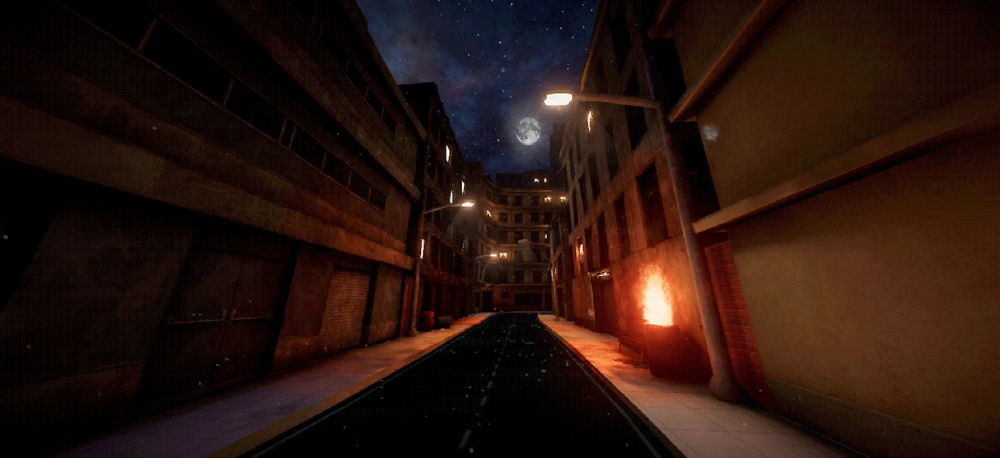

# CrowPSX: PSX shaders for Unity Built-in and URP

CrowPSX is a retro shader and material-authoring suite by **CrowBite**. It provides screen-space vertex snapping, affine texture warping, stepped lighting, and final-color posterization for PSX-inspired Unity games.

[Product website](https://luci0n.github.io/crowpsx/) · [Documentation](https://luci0n.github.io/crowpsx/docs/) · [Unity Asset Store](https://assetstore.unity.com/packages/vfx/shaders/crowpsx-retro-rendering-shader-suite-395934)

## Which Unity projects does CrowPSX support?

CrowPSX supports the **Built-in Render Pipeline** and **Universal Render Pipeline (URP)**. Both SubShaders ship in the same shader assets, and Unity selects the one matching the active pipeline. HDRP shaders are not included.

The package documentation specifies Unity 2022.3 LTS or newer and lists testing on 2022.3, 6.0, 6.3, and 6.6. Check your exact Unity, URP, and target-platform configuration in the [render pipeline documentation](https://luci0n.github.io/crowpsx/docs/render-pipelines/).

## What is included?

- Default, Lite, and PBR surface materials.
- Four-layer vertex-painted materials.
- Nature shaders with anchored foliage wind.
- TerrainLayer-driven Unity Terrain materials.
- Standard and Grab Distortion particles.
- Depth-volume decals and a procedural skybox.
- Material inspectors, presets, diagnostics, and a batch Material Manager.
- Stereo-stable snapping and separate VR snap and affine controls.

See the [shader reference](https://luci0n.github.io/crowpsx/docs/surface-shaders/) and [Material Manager guide](https://luci0n.github.io/crowpsx/docs/material-manager/).

## Where should I start?

1. [Install and validate CrowPSX](https://luci0n.github.io/crowpsx/docs/installation/).
2. [Create your first material](https://luci0n.github.io/crowpsx/docs/getting-started/).
3. [Build a PS1-inspired look in Unity](https://luci0n.github.io/crowpsx/guides/ps1-look-unity/).

For alternatives and integration tradeoffs, read the [Unity PSX shader comparison](https://luci0n.github.io/crowpsx/guides/psx-shaders-unity-comparison/). That guide is published by CrowBite and links to each compared product's documentation.

## About this repository

This repository hosts the CrowPSX website and documentation. The Unity shader package is distributed through the [Unity Asset Store](https://assetstore.unity.com/packages/vfx/shaders/crowpsx-retro-rendering-shader-suite-395934); it is not included in this website repository.
